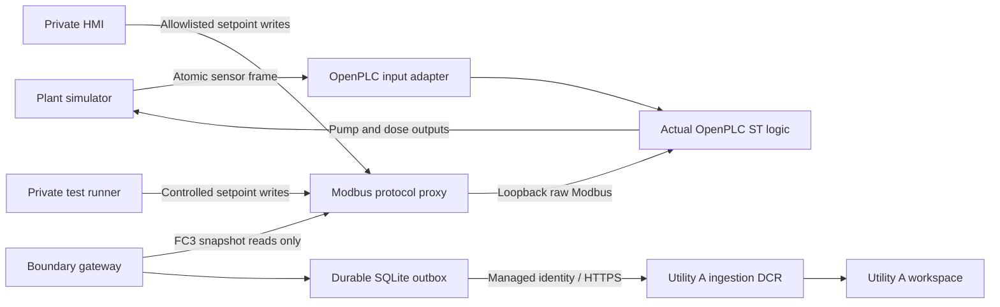

# Level 1 architecture and wider-service traceability

This repository implements a test lab, not autonomous cyber defense or a production utility integration.

| Wider architecture surface | Level 1 implementation | Deferred work |
|---|---|---|
| Utility-side collection | Synthetic IT sources; actual OpenPLC/gateway for A; synthetic OT visibility for C | Production identity, endpoint, firewall and OT connectors |
| Shared detection service | Isolated workspaces, normalization functions, reference watchlists, eleven analytics rules | Production onboarding, operational tuning and service governance |
| Agent query and audit layer | Reader identity and a separate, action-log-only ingestion DCR | The four agents, orchestration, model evaluation and approval workflows |
| Association/utility outcomes | Local evidence files, workspace workbook and optional Teams notification | Association-wide intelligence, cross-tenant aggregation and Level 2 |

Route A is the **direct-exposure** attack route; Route B is **operator-PC/remote-access compromise**. These are attack routes, not utility collection tiers. Utility A exercises the actual software-PLC process path; Utility C exercises the synthetic OT path. Neither production route is complete.

| Route or path | Level 1 evidence | Detection coverage | Explicit boundary |
|---|---|---|---|
| Route A: direct exposure | SCN-03 exposure and boundary traffic | DR-03/DR-04 | Internet exposure is simulated; the real PLC is not publicly exposed |
| Route B: operator PC/remote access | SCN-01/02/05/06/07/08 sessions, sign-ins, remote tools and zone violations | DR-01/02/08/09/10, plus process consequences | No real malware, account compromise or production remote-access connector |
| Path 1: HMI | Utility A SCN-01/08 actual HMI writes and plant response | DR-06/DR-07 | Authorized isolated test runner, not an agent control tool |
| Path 2: direct PLC | Utility A SCN-04 actual test-subnet Modbus write; Utility C synthetic OT write | DR-06/DR-07 for A; DR-05 for C | A's process gateway does not imply packet-level program-download visibility or a recorded username |
| Health and legitimate-work controls | SCN-09 feed loss; SCN-10 on-call activity | DR-11 escalation and no-High control | Original silence/latency limits remain binding |

## Utility A process boundary

All exposed analog and state words use SCALE=100. OpenPLC reads `%IW0..2`, mirrors them into `%QW0..2`, holds setpoints at `%QW10..14`, and publishes actuator outputs at `%QW20..21`. The gateway reads one 22-word snapshot.

The proxy permits gateway FC3 reads only. Allowlisted HMI/test clients may use FC6/FC16 only for the five setpoint words. Other function codes, actuator writes, debug/force access and malformed requests are rejected. The raw OpenPLC service is bound to host loopback; its control socket and web administration are not published.

The gateway's filter checkpoint, PLC failure/recovery state and queued events are committed in one SQLite transaction. Transport retries preserve record identifiers. A successful poll after reported unreachability emits a PLC recovery event; DR-11 also recognizes later valid heartbeats. Normalization functions deduplicate `RecordId` before counting detections and expose `ReceivedAt` from actual ingestion time. `ScenarioRunId` is available in raw evidence but is not projected into detection functions or used as a rule predicate.

The sensor publisher atomically replaces each complete six-byte input frame. Windows-only bounded retries accommodate transient Docker reader locks without exposing partial frames. Local restart tests publish a fixed host port so Docker restart cannot silently change the tested endpoint.

## Azure boundaries

Each utility has its own workspace, telemetry DCR, action-log DCR and ingestion-boundary UtilityId filter. Generator permissions do not grant workspace administration. The disabled-account updater has a narrowly scoped role for its reference watchlist; it cannot edit analytics rules.

A separate generator timer retains actual source receipts, fourteen-day mature access history and recent incident state in three additional watchlists. It has utility-workspace query access and write permissions scoped only to those lists, with per-utility leases and durable per-entry delivery checkpoints. This preserves long detection horizons while Sentinel's scheduled rules use supported short query periods and the original five-minute evaluation frequency. It does not backfill telemetry or simulate receipt times; recent normalized data takes precedence over stale reference state.

The boundary subnet retains explicit NAT for the permitted Azure Monitor/identity HTTPS flows. Build-time NAT attachments on control/test subnets and broad build-egress NSG rules are removed at lockdown. Those subnets disable implicit outbound access and receive a route table with `0.0.0.0/0` next hop `None`; NAT removal alone is not proof of no Internet route. A NAT public address is outbound translation, not an inbound VM listener.

Private-only Premium Bastion enables native tunneling. Supply existing private connectivity or deploy the optional operator on its own `10.10.5.0/24` subnet, without a public VM IP. Its narrowly permitted Azure HTTPS egress and separate NAT allow authenticated management commands on the operator only. Its Bastion tunnels reach the existing private test/gateway SSH endpoints with pinned host keys and noninteractive `sudo -n`; no direct operator Modbus/HMI or OT SSH rule is added. Control/test keep their null Internet routes and post-lockdown VM run-command is not assumed available there.

The operator's system identity has query/queue/test incident permissions plus Utility A resource-group Reader for Bastion metadata. Its protected SSH credential is bootstrapped separately and is never supplied to the future agent. Broad build egress is removed from the operator too. This is a separate test-operator control surface, not an implementation of any of the four agents. Cloud APIs still use authenticated HTTPS endpoints; this is not a fully private-endpoint Azure architecture.

Shared storage keeps public-network access disabled, as enforced by the deployment tenant's management-group policy. Anonymous blob access and shared-key authentication also remain disabled. Functions deployment/runtime and operator queue delivery therefore require private endpoints, private DNS and Function VNet integration; identity roles alone cannot bypass the storage network boundary. This private service path must be operationally verified before publishing or warm-up can be accepted.

The shared services network uses `10.20.0.0/16`, with a dedicated Flex-delegated `10.20.1.0/26` subnet and storage endpoints in `10.20.2.0/27`. Blob and queue endpoints have private DNS links to this network and the owned Utility A network. Two scoped peerings connect only those lab networks, without forwarded traffic or gateway transit. Endpoint HTTPS ingress is limited to the Function integration subnet and private operator subnet; the operator gains only a matching private-storage HTTPS egress rule, not OT access. Control/test deny rules and null Internet routes are unchanged. Services retain their own outbound-only NAT for runtime/build dependencies; that NAT is not attached to control/test.

## Agent contract

No agent is installed or scheduled. A future approved agent may query the `Swu*` normalization functions and write only `Custom-SimAgentAction_CL` through the separate action DCR. Minimum fields are `TimeGenerated`, `UtilityId`, `ScenarioRunId`, `RecordId`, `AgentName`, `Action`, `Target`, `ApprovedBy`, and `Result`; the remaining table schema is in `infra/tables.json`.

Use a stable unique `RecordId` for an action and its retries. This is audit data, not permission to execute the recorded action. Agents have no PLC/HMI credentials or control tool, no telemetry-DCR writer role, and no infrastructure/analytics/watchlist administration role. Live negative permission tests must prove this boundary before acceptance.

OpenPLC is fetched from pinned upstream source during the image build. Preserve upstream licensing/source notices when distributing the image; the upstream source remains in the build tree.
