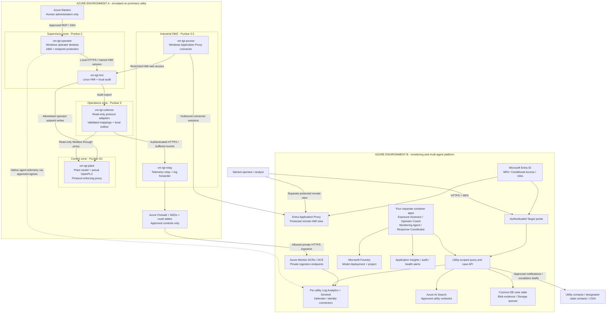

# Target physical architecture: Azure-hosted utility and multi-agent platform

## 1. Status and scope

**Status: proposed design, not provisioned or implemented.**

Everything in this lab runs in Azure. "On-premises" below means a separately
segmented, Azure-hosted emulation of a water utility. Nothing requires a real
utility connection or a lab server on the developer's computer.

The design has two environments:

- **Utility site:** local process control, HMI, Windows operator, process
  collection and industrial DMZ.
- **Cloud service:** telemetry ingestion, security monitoring, evidence,
  operator guidance and four cooperating agents.

The existing Route A and Route B deployments remain unchanged. The Target gets
new resource groups, networks, identities and data destinations. Both existing
routes represent the same simulated utility; they are not two different customers.

PLC control remains local and operator-operated. Cloud agents cannot write PLC
registers, operate the HMI, administer VMs or automatically isolate critical hosts.
This design extends beyond the implemented Level 1 lab.

## 2. Physical deployment overview

This is a functional flow diagram, not a bypass around the firewall. Inter-zone
and site-to-platform flows are enforced by the routing and allowlist in section 6.
The App Proxy connector initiates its cloud connection; the diagram does not
represent an inbound Internet connection to its VM. External communications to
incident recipients require the approval policy in section 10.

## 3. Resource groups and network placement

Proposed deployment prefix: `swutgt`. First utility: `utility-demo-001`.
Use the established CPI Azure context if deployment is later approved; do not
reuse or change the separate original-lab account context.

| Resource group | Purpose | Isolation |
|---|---|---|
| `rg-swutgt-u001-site` | Six utility-side VMs, site VNet, firewall, Bastion, NICs, disks and local collection | Emulated utility, not cloud-agent compute |
| `rg-swutgt-u001-data` | Utility workspace, Sentinel, DCRs, DCE, monitoring private-link resources and utility-specific configuration | No mixing with Route A/B or synthetic baseline tables |
| `rg-swutgt-platform` | Container Apps, Foundry, knowledge, case/evidence services, registry and platform VNet | Shared service code; utility-scoped data and authorization |

These are proposed nonoverlapping address ranges, subject to inventory and policy
validation before deployment. Subnet names, not guessed host addresses, are the
deployment contract; allocate and persist actual NIC/private-endpoint addresses.

| Network / subnet | Proposed range | Placement |
|---|---|---|
| Site VNet | `10.50.0.0/16` | Emulated utility 001 |
| `AzureFirewallSubnet` | `10.50.0.0/26` | Managed site boundary firewall |
| `snet-control` | `10.50.1.0/24` | Plant, OpenPLC and protocol proxy |
| `snet-supervisory` | `10.50.2.0/24` | HMI and Windows operator |
| `snet-operations` | `10.50.3.0/24` | Read-only collector |
| `snet-dmz` | `10.50.4.0/24` | Telemetry relay/log forwarder |
| `snet-access` | `10.50.5.0/24` | Application Proxy connector; separate from telemetry relay |
| Reserved administration subnet | `10.50.250.0/26` | Reserve for a dedicated `AzureBastionSubnet` if required |
| Platform VNet | `10.60.0.0/16` | Cloud compute and private service endpoints |
| `snet-containerapps` | `10.60.0.0/23` | Dedicated, delegated workload-profile environment subnet |
| `snet-endpoints` | `10.60.2.0/24` | Data/model/registry private endpoints, with required endpoint network policies |

Peer only the new site and platform networks as needed for approved private
ingestion. Peering is not an authorization boundary and is not transit routing.
Do not peer the Target to Route A/B. Explicit NSG denies override Azure's
otherwise permissive virtual-network defaults.

For cross-zone inspection, protected-subnet routes steer remote zone prefixes and
approved platform endpoint prefixes through the firewall. Configure symmetric
return routing on the endpoint subnet; verify effective routes and packet paths.
Do not attach workload route tables to `AzureFirewallSubnet`.

The Container Apps compute subnet has an explicit deny/null route for the site
prefix, as well as outbound policy denying site access. Agents do not need a
network path to PLCs, HMI, SSH, RDP or the local relay.

## 4. Emulated on-premises inventory

All six VMs have private NICs only. VM sizes below are starting capacity estimates,
not a claim of available subscription quota or production sizing.

| VM / component | OS and initial capacity | Software / purpose | Real versus simulated |
|---|---|---|---|
| `vm-tgt-plant` | Supported Ubuntu; about 2 vCPU / 4 GiB | Pinned OpenPLC, plant model and existing protocol-enforcing proxy | Actual software PLC; simulated tank, chlorine, sensors, motor and hydraulics |
| `vm-tgt-hmi` | Supported Ubuntu; about 2 vCPU / 4 GiB | Existing HMI image, local TLS and extended user/session/action auditing | Actual application and Linux logs |
| `vm-tgt-operator` | Windows Server 2022 Desktop Experience; about 2 vCPU / 8 GiB | Browser-based operator desktop, AMA and licensed endpoint protection | Genuine Windows/endpoint events; a server desktop emulates the workstation |
| `vm-tgt-collector` | Supported Ubuntu; about 2 vCPU / 4 GiB | Read-only adapter, versioned tag mapping, quality checks, SQLite outbox | Actual reads of simulated process values |
| `vm-tgt-relay` | Supported Ubuntu; about 2 vCPU / 4 GiB | Authenticated relay, durable outbox and CEF/Syslog forwarding | Actual transport/host logs; no invented vendor-firewall records |
| `vm-tgt-access` | Windows Server 2022; about 2 vCPU / 8 GiB | Dedicated Entra Application Proxy connector | Actual protected remote-access path; not a PLC gateway |
| Azure Firewall Standard + Firewall Policy | Managed Azure service | Stateful network/application rules, restricted egress and diagnostic logs | Genuine Azure firewall evidence representing the lab boundary, not a physical utility appliance |
| Azure Bastion | Developer SKU for lab if region/policy support it | Portal-based human access without public VM RDP/SSH | Not an agent tool; alternate SKU/connectivity needs approval if Developer is unavailable |

Plant containers share one VM for lab economy; this is not physical isolation
between a real sensor, independent motor feedback and a PLC. Use separate container
processes and retain actual OpenPLC/proxy register enforcement.

Azure VMs use their native managed identities and monitoring extensions. Do not
onboard them to Arc-enabled Servers merely to imitate on-premises. A future real
site can use supported Arc/AMA onboarding or supported workstation collection.

Server endpoint protection needs server-appropriate licensing, for example an
approved Defender for Servers plan or equivalent entitlement. Do not assume a
user's Microsoft 365 endpoint license covers these Windows Server VMs.

## 5. Cloud platform inventory and runtime choice

Use **four container-hosted agents calling Microsoft Foundry models** for the
initial Target. Each agent is a separate Container App with its own identity.
This keeps private tool access and permissions explicit.

This is one runtime choice, not a second simultaneous deployment into Foundry
Agent Service. A later move to Foundry-managed agent hosting requires equivalent
networking, identity, evaluation and approval controls.

| Cloud service / deployment unit | Initial design | Purpose |
|---|---|---|
| Microsoft Entra ID | Utility membership, application roles, MFA/Conditional Access, scoped workload identities | Human and service authentication |
| Entra Application Proxy | Publish the approved HMI view through the dedicated connector | Protected human remote access, not an agent write path |
| Azure Container Apps environment | One VNet-integrated workload-profile environment, Consumption profile | Common container hosting without Kubernetes administration |
| `ca-swutgt-portal` | Entra-protected HTTPS ingress | Insights, evidence, coaching, cases and approvals; no Target PLC control buttons |
| `ca-swutgt-u001-api` | Internal ingress; authenticated users/services; utility-scoped identity | Typed query tools, case changes, audit and evidence retrieval |
| `ca-swutgt-assessor` | Queue-driven worker; no public ingress | Exposure Assessor |
| `ca-swutgt-coach` | Queue-driven worker; no public ingress | Operator Coach |
| `ca-swutgt-monitor` | Queue-driven worker; no public ingress | Monitoring Agent |
| `ca-swutgt-coordinator` | Queue-driven worker; no public ingress | Response Coordinator |
| Container Apps scheduled jobs | Bounded exposure/monitoring dispatch; explicit schedules when approved | Admit work; do not continuously run every agent against every sample |
| Foundry resource/project and model deployments | Region, model, quota and private-access support validated before selection | Model inference; controlled model versions and evaluation |
| Azure AI Search | Approved runbooks; per-utility indexes and broker-enforced access | Cited guidance; not the source of live process state |
| Azure Cosmos DB for NoSQL | Utility-specific case containers; case/event concurrency controls | Durable cases, approvals, assignments, task deduplication and workflow state |
| Azure Storage | Per-utility evidence/state containers; per-agent work and poison queues | Latest observed snapshots, evidence, durable delivery and explicit failed-work handling |
| Azure Container Registry | Private image access; compatible private-link tier | Reviewed, immutable application images |
| Log Analytics + Sentinel | Separate Target utility workspace, native connectors, normalized security views and process/audit tables | Detection, investigation and incident records |
| Azure Monitor DCRs / DCE / private-link scope | Process/HMI ingestion, AMA collection and monitoring private endpoints | Enforce schemas, identities and destinations |
| Defender XDR / endpoint integration | Actual onboarding and chosen alert/raw-event coverage | Endpoint investigation; alerts do not imply all raw events are ingested |
| Azure Key Vault | Scoped certificate/secret use where unavoidable | Rotation and key custody; no PLC/HMI credentials for agents |
| Application Insights / Monitor / Workbooks | Filtered agent/tool traces, health alerts and operator views | Reliability, audit, freshness and usage visibility |
| Private endpoints / DNS / NSGs / route tables | Required per service, including return paths and DNS resolution | Private data access; storage public access remains disabled |
| Cost Management budgets | Approved thresholds and notifications | Cost visibility, not a hard spending stop |

There are six initial Container Apps: portal, utility API and four agents.
Scheduled jobs are additional deployment units, not more specialist agents.
The site-to-cloud network path exposes ingestion endpoints only, not the agent
tool API or model endpoints.

Private endpoints do not automatically privatize every service dependency.
Entra, Defender, App Proxy and required Azure runtime/control-plane endpoints
need documented, source-specific outbound allowances. The portal is the intended
authenticated public application surface. No data service is made public merely
to bypass a private-network error.

## 6. Allowed data and administration flows

Default-deny all other site, cross-zone and platform-to-site connections.

| Source -> destination | Protocol | Authorization / restriction |
|---|---|---|
| Plant model -> OpenPLC input adapter | Host-local input frame | Existing validated sensor contract; not a cloud endpoint |
| Windows operator -> local HMI | HTTPS 443 | Named local operator/session; local control role |
| HMI -> PLC proxy | Modbus TCP 502 | Only approved setpoint words/function codes; never raw runtime/admin access |
| Collector -> PLC proxy | Modbus TCP 502 | Proxy-enforced FC3 snapshot reads only; explicit cross-level read conduit |
| HMI -> collector audit receiver | Authenticated HTTPS 443 | Audit-only schema, source authentication and deduplication |
| Collector -> DMZ relay | HTTPS 443 with authenticated source, preferably mTLS | Versioned telemetry only; no command or executable-response field |
| Actual Syslog-capable sources -> relay | Syslog over TLS 6514 where supported | Per-source trust; declare and isolate any legacy transport exception |
| Relay -> Monitor ingestion and utility state container | HTTPS 443 over approved private endpoints | Per-utility managed identity; DCR ingest and narrowly scoped snapshot/evidence permissions |
| AMA -> monitoring endpoints | Supported HTTPS 443 paths | Native agent conduit; required private configuration/DCE endpoints and identity access |
| Endpoint agent / App Proxy connector -> Microsoft services | Vendor-required outbound endpoints | Source-specific egress rules; narrowly document additional certificate-validation ports if required |
| App Proxy connector -> HMI | HTTPS 443 | Remote-view authorization; no access to PLC port 502 |
| Azure Firewall -> utility workspace | Azure diagnostic settings | Actual resource-specific logs; retain source-resource identity |
| Entra / Defender -> Sentinel | Supported service connectors | Approved tenant, permissions, licensing and selected event coverage |
| Portal / agent -> utility API | Authenticated HTTPS | Server-issued utility scope, role, purpose and bounded task/query |
| Agent -> Foundry inference | Authenticated HTTPS | Approved deployment, input limits and telemetry redaction |
| Utility API -> data/search/case services | HTTPS / supported private SDK paths | Utility-scoped authorization; agents have no direct unrestricted data credentials |
| Human -> Bastion -> authorized VM | HTTPS portal; controlled RDP 3389 / SSH 22 to private NIC | Separate operator/admin roles and audited named identities; no agent permission |

The site relay is an application-level boundary for process/audit transfer.
AMA, Defender and App Proxy have separate supported conduits; do not claim their
traffic is automatically transformed by the custom process relay. Preserve TLS
validation; do not introduce TLS inspection that breaks vendor agents.

An outbound TLS session is not a data diode. Enforce no-control behavior in
protocol permissions, ingress/egress rules, accepted message types and identities.
Agents also receive no Azure VM Run Command, extension-management, deployment,
role-assignment or general infrastructure permissions.

Azure Firewall's proposed egress public IP is not a public PLC/HMI endpoint.
It has no OT DNAT rule. Its IP and the authenticated portal must satisfy tenant
policy; a denial is a deployment gate, not permission to weaken policy.

## 7. Local operation and MFA

The operator controls the private HMI from the utility's Windows desktop.
The HMI records its authenticated local user/session with every requested change
and the observed result. A setpoint acknowledgement is not proof of motor motion
or physical water quality.

Remote users enter through Entra preauthentication and Conditional Access/MFA.
Initial remote HMI access is read-only and enforced by the HMI/backend role,
not by hiding a button. It is separate from local control. The cloud agent portal
contains no pump/chlorine execution endpoint.

Do not claim App Proxy adds MFA to Modbus or every Windows/local HMI login.
Preauthentication alone also does not establish per-command Entra identity:
federation or validated session/identity mapping is needed for that attribution.
Never trust an arbitrary client-supplied identity header.

Local operation has a documented, restricted offline authentication procedure
and audited emergency access. Remote access fails closed during identity-service
failure; local safety/control must not depend on Azure sign-in availability.
In the emulation, loss of the monitoring platform can be tested independently;
a provider-wide Azure outage can still stop the Azure-hosted "local" VMs.

## 8. Telemetry contracts and evidence quality

| Family | Proposed normalization | Original evidence |
|---|---|---|
| Process observation | Versioned schema: metric, value, unit, quality, observation time, asset and source | Actual PLC reads from the software plant; optional reviewed historian/OPC UA adapter later |
| HMI control audit | User/session, action, tag, old/new value, command result and independent readback | Actual application audit, including explicit failed/interrupted outcomes |
| Authentication / network / process / file | Native connector tables plus ASIM views where supported | Actual Windows, Entra, Defender and firewall records |
| Asset / identity context | Stable utility/site/asset IDs and time-aware address/account mappings | Approved inventory/configuration, not an LLM-invented relationship |
| Agent / case audit | Task, utility, agent, tool, evidence references, approval, outcome and timestamps | Actual tool calls and case transitions |

Use common identity/context fields across the families, not one universal event
table. Bind the utility identity to the authenticated source and allowed
destination. A payload's `UtilityId` alone is not tenant isolation.

Keep actual Target process/audit tables separate from the existing `Sim*` lab
tables. Label process values as `SourceKind=SimulatedProcess`; label genuine OS
or cloud events by their actual source. Mark deliberately injected scenarios
as test signals. Never fabricate native Entra/Defender/firewall rows.

Each event carries a stable event ID, schema version, source asset, observation
time and quality. Preserve receipt/ingestion time separately. Use at-least-once
delivery with deduplication, bounded retries, disk limits and explicit outbox/
poison alerts; do not claim exactly-once delivery.

A reasonable initial acquisition interval is five seconds, with configured
batching/change thresholds and heartbeats. Validate ingestion/freshness targets
under load before claiming a live latency guarantee. The portal shows actual
last-observed time, stale/unknown states and no invented animation progression.
Missing or invalid readings must not silently become zero or "normal."

## 9. Agent responsibilities, permissions and durable handoffs

| Agent | Evidence and output | Explicit exclusion |
|---|---|---|
| Exposure Assessor | Approved asset inventory, Azure exposure configuration, authorized external observations; prioritized findings | No unapproved Internet/OT scanning and no deliberate public PLC exposure |
| Operator Coach | Utility-approved runbooks and case evidence; cited, step-by-step guidance with verification points | No generic unsafe operating instruction or automatic computer/PLC action |
| Monitoring Agent | Bounded security/process queries; evidence-backed hypotheses, confidence and missing-data warnings | No assertion that a process anomaly alone proves cyberattack |
| Response Coordinator | Case timeline, ownership, follow-up, draft situation reports and authorized escalation | No assumed authority to contact government agencies or contain equipment |

Deterministic rules detect critical conditions and feed-health failures even if
models are unavailable. Agents investigate relevant alerts/findings and operator
questions; raw samples are not individually sent to a model.

An authenticated API admits each task with a server-issued utility scope,
authorized user/service, task ID, allowed tools and expiry. Queue payloads and
prompts cannot expand that scope. Each role consumes its own work queue, uses
bounded retries and places exhausted work in a visible poison queue.

Case state, evidence references, approvals and completed task IDs persist outside
the containers. Use conditional updates/transactional case changes as appropriate
to avoid duplicate transitions. Restarting a worker must not duplicate an
approved external send. Uncertain delivery receipts require review, not blind
replay. Evidence-changing tasks invalidate earlier approvals where appropriate.

The utility API mediates tool access. It has only the required utility workspace,
case container and evidence permissions; no PLC credentials. Keep per-utility
indexes and enforce retrieval authorization at the API. Separate services/accounts
are required if a customer's isolation or residency policy demands a harder
boundary than shared-service authorization.

## 10. Incident coordination and human approvals

Use an explicit case lifecycle:

`new -> triage -> investigating -> action-proposed -> awaiting-approval -> action-recorded -> verified -> closed`

Record who approved what, the exact approved content/action, evidence snapshot
and expiry. Rejection, timeout, failure and unknown delivery are explicit states.
The UI never represents model-generated advice as an executed remediation.

Internal notifications follow the approved utility policy. External escalation
requires verified contacts, sharing authorization, data minimization and an
approved channel. Initial state/CISA outputs are drafts/packages for an authorized
person to review and submit; do not assume a government API or automatic reporting
integration exists. Legal notification duties require jurisdiction-specific review.

Approved sharing does not mean unrestricted cross-utility telemetry access.
Each utility owns its records. Association-wide trends require a separately
authorized, minimized aggregation path, not shared raw-log browsing.

## 11. Reuse across real utilities

Deploy one site module per utility and reuse cloud application images/tools.
Onboarding supplies inventory, tag maps/scaling, units, thresholds, runbooks,
identities, approved egress and escalation/sharing policy.

| Azure-emulated component | Future real-site equivalent |
|---|---|
| Plant VM / software sensors | Actual PLC/RTU, instrumentation and actuator feedback |
| Linux HMI and Windows desktop | Existing supported HMI/operator estate |
| Read-only Modbus adapter | Supported historian/OPC UA/vendor adapter; validate every tag mapping |
| DMZ relay VM | Utility-owned or approved industrial gateway/relay |
| Azure Firewall lab logs | Actual utility firewall/VPN CEF/Syslog/API connector |
| Azure VM identity/AMA | Supported on-prem server/workstation identity and monitoring onboarding |
| Private VNet peering | Approved routed VPN/private connection, or permitted outbound HTTPS ingestion |

Purdue provides placement; IEC 62443 risk-based zones/conduits provide boundaries.
OPC UA/SensorThings concepts can inform process semantics, ASIM normalizes
security queries, and Sparkplug is an optional industrial telemetry adapter.
Do not require Kubernetes, IoT Hub, MQTT, replacement PLCs or one equipment vendor
for every utility.

## 12. Cost, deployment gates and proof

This is a complete logical/physical reference design, not an approved Azure bill
or a claim that every SKU is available. The lab starts with one emulated utility,
six VMs, two VNets, one firewall, six Container Apps and bounded scheduled jobs.
It is not a high-availability production deployment.

Budget before deployment for Windows licensing/endpoint protection, VM disks,
Azure Firewall, private-link-capable registry/search tiers, model tokens and
telemetry retention. Scale idle agent workers to zero where trigger support
permits; cap replicas, execution time, tool calls and token budgets.

Deallocating VMs does not stop charges for managed firewall, search, registry,
disks, private endpoints or retention. Target-specific lifecycle automation must
drain work, preserve evidence and support an explicitly approved managed-service
teardown/recreation strategy. Do not extend existing Route A/B stop scripts by
guessing the new resource inventory.

Before provisioning, verify subscription/tenant, budget, regional SKU/model
capacity, address overlap, policy, private DNS/endpoint routing, MFA licensing,
server endpoint entitlements and Bastion availability/access requirements.
Existing policies, accounts and Route A/B resources must not be changed as a
fallback. No live utility, malware or public OT exposure is required for testing.

| Proof required | Acceptance evidence |
|---|---|
| Local control independence | Stop cloud ingestion/agents; local HMI/PLC loop continues; UI reports cloud/feed loss honestly |
| Network enforcement | Denied public access; allowed read/HMI paths; actual rejected collector writes and agent-to-site connections |
| Genuine collection | Source events and receipt times from Windows, Linux, Entra, endpoint protection and firewall; clear process simulation labels |
| Identity and MFA | Successful protected access, denied unauthorized access, backend-bypass denial and documented local/offline behavior |
| Process interpretation | Known units/scaling, high/low/rate/stale/quality cases and no invented human attribution |
| Agent safety | Negative permission tests, bounded tools, grounded guidance, injection-resistant authorization and no PLC/admin/containment tool |
| Utility isolation | Utility 002 cannot query utility 001's logs, cases, documents or evidence; approved aggregation is separate |
| Durable coordination | Restart, duplicate task, expired/rejected approval, poison work and uncertain-notification receipt tests |
| Operational cost | Measured ingestion/token/storage use and explicit remaining-cost report after shutdown |

Implementation sequencing: site isolation and local process first; genuine
telemetry and MFA second; deterministic detections and operator views third;
bounded agents and approved case workflows fourth; second-utility onboarding
and isolation proof last. No infrastructure is provisioned by this document.

## References

- [NIST SP 800-82 Rev. 3: Guide to OT Security](https://csrc.nist.gov/pubs/sp/800/82/r3/final)
- [ISA/IEC 62443 series](https://www.isa.org/standards-and-publications/isa-standards/isa-iec-62443-series-of-standards)
- [Azure Container Apps VNet requirements](https://learn.microsoft.com/en-us/azure/container-apps/custom-virtual-networks)
- [Azure Firewall](https://learn.microsoft.com/en-us/azure/firewall/overview)
- [Azure Bastion deployment and Developer SKU](https://learn.microsoft.com/en-us/azure/bastion/quickstart-host-portal)
- [Entra Application Proxy](https://learn.microsoft.com/en-us/entra/identity/app-proxy/overview-what-is-app-proxy)
- [Azure Monitor Logs Ingestion API](https://learn.microsoft.com/en-us/azure/azure-monitor/logs/logs-ingestion-api-overview)
- [Microsoft Sentinel ASIM](https://learn.microsoft.com/en-us/azure/sentinel/normalization)
- [OGC SensorThings API](https://www.ogc.org/standards/sensorthings/)
- [Eclipse Sparkplug specification](https://sparkplug.eclipse.org/specification/)
