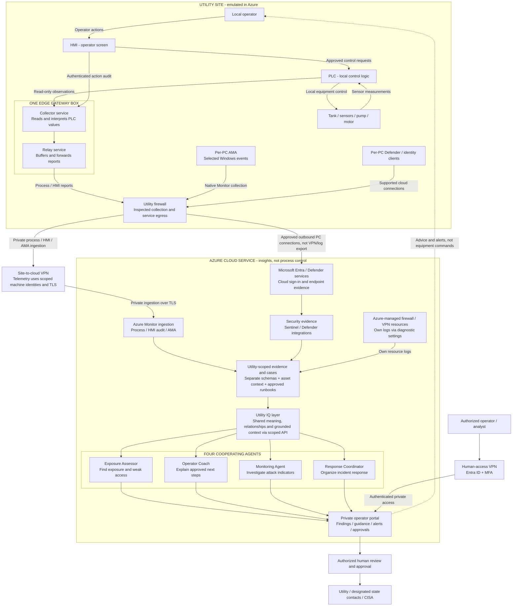
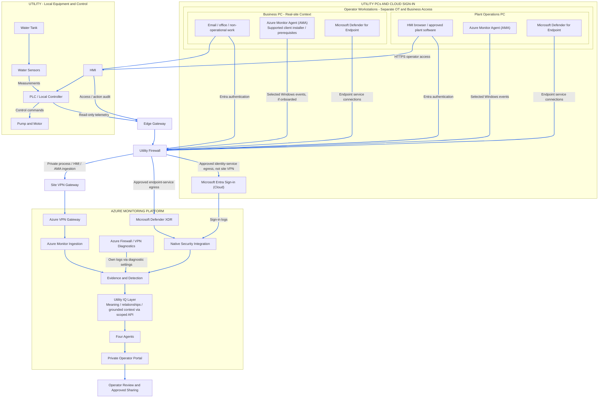
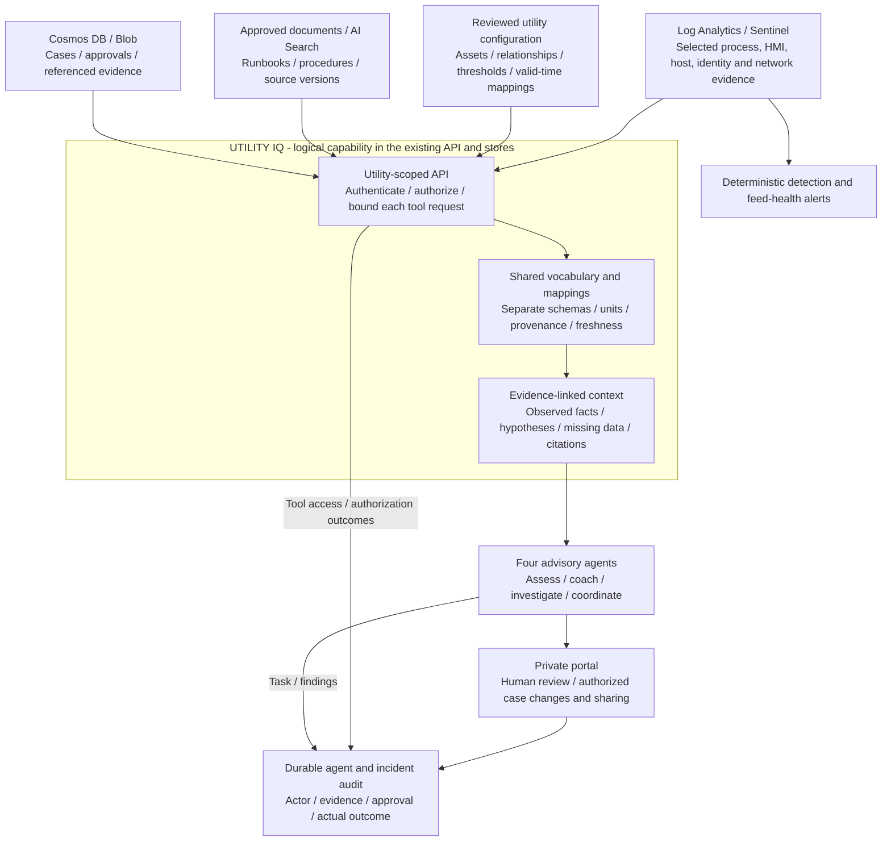

# Target physical architecture: Azure-hosted utility and multi-agent platform

## 1. Status and scope

**Status: proposed design, not provisioned or implemented.**

Everything in this lab runs in Azure. "On-premises" below means a separately
segmented, Azure-hosted emulation of a water utility. Nothing requires a real
utility connection or a lab server on the developer's computer.

The design has two environments:

- **Utility site:** local process control, HMI, Windows operator, process
  collection and industrial DMZ.
- **Cloud service:** telemetry ingestion, security monitoring, evidence,
  operator guidance and four cooperating agents.

The Target has **one secured architecture, not Route A and Route B**. All remote
human access uses VPN with Entra ID and MFA; the Target portal, HMI, VMs and data
services have no public application ingress. Existing comparison labs are outside
the Target and remain unchanged. The Target gets new resource groups, networks,
identities and data destinations.

Interpretation of the access correction: "no open ports" means **no public
application/OT ports**, not literally no network listeners. VPN gateways still
need their required public VPN endpoints. Internal HTTPS, RDP and industrial
protocol ports exist only on approved private paths. This is the conservative
design assumption pending review of the user's abbreviated wording.

PLC control remains local and operator-operated. Cloud agents cannot write PLC
registers, operate the HMI, administer VMs or automatically isolate critical hosts.
This design extends beyond the implemented Level 1 lab.

### Conceptual architecture: who reads, forwards, analyzes and controls

**The operator controls; the collector reads; the relay forwards; Azure analyzes.**
This view explains responsibilities rather than VM names, sizes or subnets.
The collector and relay are two software services on **one physical edge gateway**.
In the Azure-emulated site, that box is one VM named `vm-tgt-gateway`, not the
managed VPN gateway.

The two VPN boxes are different functions: people authenticate with Entra ID/MFA;
the site's automated link authenticates gateways and workloads, without an MFA
prompt for every message. The site connection carries private process/HMI
ingestion and selected Windows events from AMA. Defender and identity clients
instead use approved firewall
service egress. Entra/Defender cloud evidence uses native connectors, while the
Azure-managed firewall and VPN resources export their own logs through diagnostic
settings; neither cloud-log path traverses the site collection gateway or VPN.
These paths do not imply a universal schema or security collection through IoT Hub.
Native cloud security connectors do not originate from the PLC.

IoT Hub and an OT security sensor are optional future integrations, not shown as
required components or newly selected/deployed resources. The base design uses
HTTPS process ingestion. An OT sensor needs validated traffic visibility; it is
not another water sensor. The detailed inventory and restrictions follow below.

No cloud agent arrow ends at the HMI, PLC or equipment. External sharing remains
subject to verified recipients and case-specific authorization.

## 2. Physical deployment overview

### Logical architecture companion

[Open the Target logical architecture SVG](target-logical-architecture.svg).
This grouped-box view shows local control, collection/transport, evidence,
four agents and private operator access. It describes the proposed Target,
not the deployed Route A/B labs. Native endpoint/identity integrations retain
their supported paths; not every log traverses the edge collection application.
The firewall-to-Microsoft-services arrow represents approved outbound PC
authentication and Defender connections, not firewall log export. Entra/Defender
cloud evidence uses native connectors; the Azure-managed firewall and VPN
resources export their own logs separately through diagnostic settings.
The SVG places AMA and Defender for Endpoint inside each PC and explains their
selected collection coverage at the bottom. These are per-PC software components,
not a shared collector host. Business-PC AMA requires the supported Windows client
installer and validated prerequisites; the business PC remains real-site context,
not another provisioned lab VM.
The Utility IQ layer adds shared meaning and evidence relationships through the
existing scoped API and stores; it is not another agent, VM or ingestion gateway.
See section 8.3 for its purpose, implementation approach and dedicated diagram.

### 2.1 Layered physical architecture and components

Read the numbered layers from utility equipment toward Azure insights.
These are presentation layers, **not new Purdue levels or automatic security
boundaries**. Purdue placement is shown only for the utility-side functions.
Both environments run in Azure in this lab; the utility column describes where
the corresponding component would run at a real site.

| Layer | Architectural components | Utility/on-premises or cloud | Physical deployment in this lab |
|---|---|---|---|
| 1. Local process and control | Tank, sensors, pump/motor; PLC/RTU or other local controller; protocol-enforcing read boundary | Utility/on-premises; Purdue 0/1 | One `vm-tgt-plant`: simulated physical process, actual OpenPLC and proxy as software components; not separate physical devices |
| 2. Operator supervision | HMI, dedicated plant operations PC, named operator access, local audit, Windows AMA and endpoint protection | Utility/on-premises; Purdue 2 | `vm-tgt-hmi` and `vm-tgt-operator` in `snet-supervisory`; planned Entra VM sign-in, no routine email/general browsing |
| Business-work context | Separate PC for email, office applications and non-operational work; separate Entra business permissions; per-PC AMA and Defender for Endpoint subject to supported onboarding/licensing | Utility/on-premises business/IT network, outside plant control | Existing real-site workstation shown for context; AMA client installer/prerequisites must be validated; no additional business VM provisioned or included in the initial four-VM emulation |
| 3. Edge collection and forwarding | Read-only adapters, validated mappings, collector service, local durable outbox, relay and supported log receiver | Utility/on-premises; industrial DMZ | One `vm-tgt-gateway` in `snet-dmz`; two services on one box, not a VPN router |
| 4. Site network protection and tunnel | Firewall policy, NSGs, inspected routes and site VPN termination | Utility/on-premises boundary | Azure Firewall Standard and site Azure VPN Gateway; managed services, not extra utility VMs |
| 5. Private cloud entry and ingestion | Platform VPN termination, private DNS, monitoring private-link scope, DCE/DCRs and native security connectors | Cloud | Platform Azure VPN Gateway, Private DNS Resolver and Azure Monitor ingestion resources; scoped private HTTPS paths |
| 6. Evidence, detection and knowledge | Process/security records, deterministic detections, cases, evidence, work/poison queues, approved runbooks and IQ context/relationships | Cloud | Utility Log Analytics/Sentinel, Cosmos DB, Blob/Queue Storage and Azure AI Search; IQ logic uses the existing utility API and stores |
| 7. Agent reasoning and authorized tools | Exposure Assessor, Operator Coach, Monitoring Agent, Response Coordinator; scoped query/case API; model inference | Cloud | Four agent Container Apps, `ca-swutgt-u001-api` and Foundry models; agents use the API for evidence/tools |
| 8. Operator insights and coordination | Private portal, findings, alerts, guidance, approval and incident packages | Cloud, accessed by authorized people over VPN | `ca-swutgt-portal`; human-approved utility/state/CISA communication, not equipment control |
| Cross-cutting foundations | Identity/MFA, workload roles, private endpoints/DNS, image supply, certificate custody, audit/health and budgets | Both, with cloud-managed services | Entra ID, managed identities, internal Container Apps environment, ACR, Key Vault, Application Insights/Monitor/Workbooks and Cost Management |

**Physical count:** four utility VMs and six cloud Container Apps. The two VPN
gateways and firewall are additional managed services, not included in the VM
count. A real site's firewall may also terminate its VPN; this Azure emulation
uses separate services. IoT Hub remains optional, not an extra required layer.

### 2.2 Layered deployment diagram

Entra is grouped near the PCs for presentation; it remains a
cloud identity service, not a service hosted inside the utility network.
The two PC boxes are peers for presentation, not a shared network/security zone.
Only the plant operations PC has the HMI access path; business access stays
separate. The inner boxes are components, not extra VMs. In the lab, the tank, sensors
and pump/motor are simulated on the plant VM alongside actual OpenPLC; the HMI
and plant operations PC use their existing proposed VMs. The business PC is
real-site context, outside the initial four-VM lab inventory; this diagram does
not provision an extra workstation. Both PCs' planned Entra authentication passes
through approved firewall egress, not the site VPN. These sign-in paths do not
grant plant-control permissions or imply completed onboarding.
Sensors send measurements, such as tank level, to the PLC. The PLC uses those
inputs and local operator requests to issue pump control commands. It does not
supply motor power: commands act through a local starter/drive where applicable,
omitted here for simplicity. The PLC-to-gateway arrow represents read responses,
not equipment commands from Azure.

**Utility collectors converge at the site firewall, not all at the edge
collection application.** The edge gateway prepares process/HMI records; native
host/endpoint agents retain their own collection protocols. Both use the
controlled utility network boundary. Private Monitor ingestion traverses the
site and Azure VPN gateways; supported Defender cloud traffic uses separately
approved firewall egress, not an assumed private/VPN-only endpoint.

Each PC contains its own AMA and Defender for Endpoint software, not a shared
collector host or another VM. The plant operations Server VM uses its supported
AMA VM extension; the business Windows client requires the supported AMA client
installer and validated prerequisites. Each PC needs its own AMA DCR association/
Windows audit configuration and Defender onboarding with appropriate licensing.
AMA collects selected logon/RDP, system/application and enabled audit events;
Defender collects endpoint alerts and selected suspicious program/file/network
evidence, subject to policy and licensing. The cloud diagnostics box represents
diagnostic settings for the Azure-managed firewall and both VPN gateways, not
utility-host traffic or another appliance. Entra records and these Azure resource
diagnostics originate in cloud services; routing them down to the edge gateway
and back to Azure is unnecessary. Native security integration groups
Entra/Defender connector functions, not one universal receiver or a new custom
service. Azure firewall/VPN diagnostic exports
have their own path to the workspace, separate from PC service connections.

| Signal source | Examples of evidence | Proposed collection path |
|---|---|---|
| PLC/process | Tank level, chlorine measurements and pump state | Read-only edge gateway -> site firewall -> VPN -> Azure Monitor process ingestion |
| HMI | Application sign-in, session, access and operator action/result | Authenticated HMI audit -> edge gateway -> site firewall -> VPN -> Azure Monitor audit ingestion |
| Plant operations Windows VM | Selected successful/failed Windows logons, RDP access and enabled OS audit events | AMA + approved DCR/event selection -> site firewall/VPN -> supported private Monitor endpoints |
| Business Windows PC (real-site context) | Selected Windows logon, system/application and enabled audit events | Supported AMA client installer + validated prerequisites and approved DCR/event selection -> approved firewall/private Monitor path; validate site VPN/private DNS reachability before enabling this feed; no extra initial lab VM |
| Plant and business endpoints | Endpoint alerts and selected process/file/network evidence | Supported Defender for Endpoint agents -> approved site-firewall egress -> Defender XDR -> approved Sentinel connector/event coverage |
| Microsoft Entra | Cloud sign-ins, MFA/Conditional Access outcomes and available identity-risk evidence | Entra service connector -> utility Sentinel workspace |
| Utility firewall | Actual allowed/blocked network/application traffic records | Azure Firewall diagnostic settings in this lab -> workspace; a real appliance uses its supported CEF/Syslog/API connector and approved forwarder |
| Site and platform VPN gateways | Connection, tunnel, gateway and supported route diagnostics | Azure diagnostic settings -> workspace; correlate human VPN access with Entra evidence |

Entra sign-ins are cloud identity events; they do not replace Windows logon/RDP
events or HMI sessions. Endpoint alerts do not imply every raw endpoint event is
available: validate audit policy, agent/connector support, permissions, licensing
and retention for each selected signal. The business PC and its endpoint feed
remain real-site context, not an additional initial lab VM or an already onboarded
endpoint. No Target signal collection is deployed by this document.

Only process/HMI records use the drawn custom edge collection path. A real-site
firewall can also export supported CEF/Syslog through an approved forwarder,
potentially the edge gateway with its native log-forwarding configuration.
Do not confuse that with Azure resource diagnostics or force AMA/Defender
through an unsupported custom proxy. Native collection retains its supported
routes; the arrows
do not imply all Microsoft endpoints become private or traverse the site VPN.
Required source-specific outbound identity/endpoint dependencies remain allowed
under section 6. Human portal access still uses VPN, Entra ID and MFA.
The authorized tool API and supporting services remain in the component table;
sections 6 and 10 retain the network restrictions and sharing approvals.

## 3. Resource groups and network placement

Proposed deployment prefix: `swutgt`. First utility: `utility-demo-001`.
Use the established CPI Azure context if deployment is later approved; do not
reuse or change the separate original-lab account context.

| Resource group | Purpose | Isolation |
|---|---|---|
| `rg-swutgt-u001-site` | Four utility-side VMs, site VNet/VPN gateway, firewall, NICs, disks and local collection | Emulated utility, not cloud-agent compute |
| `rg-swutgt-u001-data` | Utility workspace, Sentinel, DCRs, DCE, monitoring private-link resources and utility-specific configuration | No mixing with comparison-lab or synthetic baseline tables |
| `rg-swutgt-platform` | Container Apps, Foundry, knowledge, case/evidence services, registry, platform VNet/VPN gateway and private DNS resolver | Shared service code; utility-scoped data and authorization |

These are proposed nonoverlapping address ranges, subject to inventory and policy
validation before deployment. Subnet names, not guessed host addresses, are the
deployment contract; allocate and persist actual NIC/private-endpoint addresses.

| Network / subnet | Proposed range | Placement |
|---|---|---|
| Site VNet | `10.50.0.0/16` | Emulated utility 001 |
| `AzureFirewallSubnet` | `10.50.0.0/26` | Managed site boundary firewall |
| `snet-control` | `10.50.1.0/24` | Plant, OpenPLC and protocol proxy |
| `snet-supervisory` | `10.50.2.0/24` | HMI and Windows operator |
| `snet-operations` | `10.50.3.0/24` | Reserved for future utility operations; no initial VM |
| `snet-dmz` | `10.50.4.0/24` | Combined edge gateway: collector and relay services |
| Site `GatewaySubnet` | `10.50.254.0/27` | Site route-based VPN gateway |
| Platform VNet | `10.60.0.0/16` | Cloud compute and private service endpoints |
| `snet-containerapps` | `10.60.0.0/23` | Dedicated, delegated workload-profile environment subnet |
| `snet-endpoints` | `10.60.2.0/24` | Data/model/registry private endpoints, with required endpoint network policies |
| `snet-dns-inbound` | `10.60.3.0/27` | Dedicated private DNS resolver inbound endpoint subnet |
| Platform `GatewaySubnet` | `10.60.254.0/27` | Platform route-based VPN gateway; P2S and IPsec connections |
| P2S client pool | `10.250.0.0/24` | VPN client addresses, not a VNet subnet; validate client-network overlap |

Connect the site and platform VNets using a route-based VNet-to-VNet IPsec tunnel,
emulating a real site's S2S VPN. Do not add a direct peering bypass. Use
BGP-capable gateways, for example a supported `VpnGw1AZ` configuration, with
distinct private ASNs and validated capacity. BGP and explicit client routes are
needed for P2S clients to reach the remote site correctly.

The platform gateway admits approved human users through OpenVPN and Entra ID
with Conditional Access/MFA. Use the supported Microsoft-registered Azure VPN
Client configuration, not the retiring manually registered client design.
The site tunnel uses gateway/machine authentication and protected tunnel keys,
not interactive MFA. Telemetry still authenticates independently with scoped
workload identities over TLS inside the VPN.

For cross-zone inspection, protected-subnet routes steer remote zone prefixes,
the P2S client pool and approved platform endpoint prefixes through the site
firewall, then the VPN.
Keep endpoint return routes through the platform gateway. Configure supported,
specific site-gateway routes for the protected site subnets through the firewall
to preserve symmetric inspection. Verify effective routes and BGP/client routes.
Do not put an NSG or a forced default route on `GatewaySubnet`, disable required
gateway route propagation, or apply workload routes to `AzureFirewallSubnet`.

The private DNS resolver supplies reachable DNS to VPN clients; configure its
private address and private zones/suffixes in the supported client profile.
Link required private DNS zones to the appropriate VNets. Private portal,
Container Apps and service endpoint names must resolve only to approved private
addresses. DNS access is private TCP/UDP 53 from approved sources.

The Container Apps compute subnet has an explicit deny/null route for the site
prefix, as well as outbound policy denying site access. Agents do not need a
network path to PLCs, HMI, SSH, RDP or the local edge gateway.

## 4. Emulated on-premises inventory

All four VMs have private NICs only. VM sizes below are starting capacity estimates,
not a claim of available subscription quota or production sizing.

| VM / component | OS and initial capacity | Software / purpose | Real versus simulated |
|---|---|---|---|
| `vm-tgt-plant` | Supported Ubuntu; about 2 vCPU / 4 GiB | Pinned OpenPLC, plant model and existing protocol-enforcing proxy | Actual software PLC; simulated tank, chlorine, sensors, motor and hydraulics |
| `vm-tgt-hmi` | Supported Ubuntu; about 2 vCPU / 4 GiB | Existing HMI image, local TLS and extended user/session/action auditing | Actual application and Linux logs |
| `vm-tgt-operator` | Windows Server 2022 Desktop Experience; about 2 vCPU / 8 GiB | Dedicated plant operations desktop: HMI browser, approved plant software, planned `AADLoginForWindows` extension with system-assigned identity and scoped VM login role, AMA and licensed endpoint protection | Genuine Windows/endpoint events; a server desktop emulates the workstation; no routine email/general browsing |
| `vm-tgt-gateway` | Supported Ubuntu; about 2 vCPU / 4 GiB, subject to combined-load sizing | Collector and relay as separate services: read-only adapters, versioned tag mapping, quality checks, durable SQLite outbox, authenticated telemetry and CEF/Syslog forwarding | Actual reads of simulated process values and actual transport/host logs; no invented vendor-firewall records |
| Azure Firewall Standard + Firewall Policy | Managed Azure service | Stateful network/application rules, restricted egress and diagnostic logs | Genuine Azure firewall evidence representing the lab boundary, not a physical utility appliance |
| Two Azure VPN Gateways | Supported route-based/BGP-capable SKU | Platform P2S entry and site-to-platform IPsec tunnel | Genuine VPN authentication, connection and tunnel evidence |

The edge gateway is one physical box at a real utility and one VM in this lab.
Its collector prepares records in a permission-controlled local outbox; its relay
forwards them, with bounded retries and explicit delivery/freshness failures.
Use separate OS service accounts and a host-local handoff. Shared-host services
are not separate security zones: host compromise can reach both the permitted
equipment-read path and cloud-ingestion path, including the VM's workload identity.

Place the gateway on one private DMZ NIC, without IP forwarding, network bridging
or public ingress. Permit only reviewed equipment reads, authenticated audit/log
receivers and required outbound ingestion/agent dependencies. The separate
plant-side proxy must reject gateway writes regardless of which gateway service
initiates them. This intentionally trades the earlier collector/relay host
separation for small-utility simplicity; retain separate hosts where a real
utility's risk assessment requires a stronger boundary. Local control continues
if the gateway fails, but monitoring becomes stale and must alert.

No App Proxy connector VM or Bastion deployment is part of this design.
Approved users reach the private operator desktop over VPN. OS/HMI authorization
remains separate from VPN membership. An approved administration role may use
private SSH/RDP; ordinary analysts and agents do not inherit that access.

Plant containers share one VM for lab economy; this is not physical isolation
between a real sensor, independent motor feedback and a PLC. Use separate container
processes and retain actual OpenPLC/proxy register enforcement.

Azure VMs use their native managed identities and monitoring extensions. Do not
onboard them to Arc-enabled Servers merely to imitate on-premises. A future real
site can use supported Arc/AMA onboarding or supported workstation collection.

Server endpoint protection needs server-appropriate licensing, for example an
approved Defender for Servers plan or equivalent entitlement. Do not assume a
user's Microsoft 365 endpoint license covers these Windows Server VMs.

## 5. Cloud platform inventory and runtime choice

Use **four container-hosted agents calling Microsoft Foundry models** for the
initial Target. Each agent is a separate Container App with its own identity.
This keeps private tool access and permissions explicit.

This is one runtime choice, not a second simultaneous deployment into Foundry
Agent Service. A later move to Foundry-managed agent hosting requires equivalent
networking, identity, evaluation and approval controls.

| Cloud service / deployment unit | Initial design | Purpose |
|---|---|---|
| Microsoft Entra ID | Utility membership, application roles, MFA/Conditional Access, scoped workload identities | Human and service authentication |
| VPN Gateway + Private DNS Resolver | Entra-authenticated P2S entry, IPsec site link and private client DNS | All remote human and site-to-platform access uses the approved VPN paths |
| Azure Container Apps environment | One internal VNet-integrated workload-profile environment, Consumption profile | No public environment ingress; common container hosting |
| `ca-swutgt-portal` | Private HTTPS ingress reachable over VPN; Entra application authorization | Insights, evidence, coaching, cases and approvals; no Target PLC control buttons |
| `ca-swutgt-u001-api` | Internal ingress; authenticated users/services; utility-scoped identity | Typed query tools, case changes, audit and evidence retrieval |
| `ca-swutgt-assessor` | Queue-driven worker; no public ingress | Exposure Assessor |
| `ca-swutgt-coach` | Queue-driven worker; no public ingress | Operator Coach |
| `ca-swutgt-monitor` | Queue-driven worker; no public ingress | Monitoring Agent |
| `ca-swutgt-coordinator` | Queue-driven worker; no public ingress | Response Coordinator |
| Container Apps scheduled jobs | Bounded exposure/monitoring dispatch; explicit schedules when approved | Admit work; do not continuously run every agent against every sample |
| Foundry resource/project and model deployments | Region, model, quota and private-access support validated before selection | Model inference; controlled model versions and evaluation |
| Azure AI Search | Approved runbooks; per-utility indexes and broker-enforced access | Cited guidance; not the source of live process state |
| Azure Cosmos DB for NoSQL | Utility-specific case containers; case/event concurrency controls | Durable cases, approvals, assignments, task deduplication and workflow state |
| Azure Storage | Per-utility evidence/state containers; per-agent work and poison queues | Latest observed snapshots, evidence, durable delivery and explicit failed-work handling |
| Azure Container Registry | Private image access; compatible private-link tier | Reviewed, immutable application images |
| Log Analytics + Sentinel | Separate Target utility workspace, native connectors, normalized security views and process/audit tables | Detection, investigation and incident records |
| Azure Monitor DCRs / DCE / private-link scope | Process/HMI ingestion, AMA collection and monitoring private endpoints | Enforce schemas, identities and destinations |
| Defender XDR / endpoint integration | Actual onboarding and chosen alert/raw-event coverage | Endpoint investigation; alerts do not imply all raw events are ingested |
| Azure Key Vault | Scoped certificate/secret use where unavoidable | Rotation and key custody; no PLC/HMI credentials for agents |
| Application Insights / Monitor / Workbooks | Filtered agent/tool traces, health alerts and operator views | Reliability, audit, freshness and usage visibility |
| Private endpoints / DNS / NSGs / route tables | Required per service, including return paths and DNS resolution | Private data access; storage public access remains disabled |
| Cost Management budgets | Approved thresholds and notifications | Cost visibility, not a hard spending stop |

There are six initial Container Apps: portal, utility API and four agents.
Scheduled jobs are additional deployment units, not more specialist agents.
The site-to-cloud network path exposes ingestion endpoints only, not the agent
tool API or model endpoints.

There is no public portal, public HMI, public agent API or App Proxy bypass.
Private endpoints do not automatically privatize every service dependency.
Entra, Defender and required Azure runtime/control-plane endpoints still need
documented, source-specific outbound allowances. This is not permission to
expose a Target application. No data service is made public to bypass a
private-network error. A supported VPN client and browser are access clients,
not locally hosted lab servers; no client installation is performed by this design.

## 6. Allowed data and administration flows

Default-deny all other site, cross-zone and platform-to-site connections.

| Source -> destination | Protocol | Authorization / restriction |
|---|---|---|
| Approved human -> platform VPN gateway | OpenVPN using the supported Azure VPN Client | Entra-authenticated user/group policy and Conditional Access/MFA; only VPN ingress is public |
| Site VPN gateway <-> platform VPN gateway | IPsec/IKEv2, with BGP routing inside the tunnel | Protected machine/tunnel authentication; scoped routed prefixes, no interactive MFA |
| VPN client -> private portal / DNS | HTTPS 443; private DNS TCP/UDP 53 | Authorized portal role, private DNS resolution and explicit VPN client routes |
| VPN client -> operator desktop / authorized admin target | Private RDP 3389 / SSH 22 as approved | Separate named OS/VM roles; VPN membership alone is not login authorization |
| Business PC / business role -> plant HMI, PLC and edge gateway | No permitted business-work conduit | Deny business-network OT access and do not grant plant VM/HMI roles through business membership |
| Plant model -> OpenPLC input adapter | Host-local input frame | Existing validated sensor contract; not a cloud endpoint |
| Windows operator -> local HMI | HTTPS 443 | Named local operator/session; local control role |
| HMI -> PLC proxy | Modbus TCP 502 | Only approved setpoint words/function codes; never raw runtime/admin access |
| Edge gateway collector service -> PLC proxy | Modbus TCP 502 | Proxy-enforced FC3 snapshot reads only for the gateway host; explicit DMZ-to-control read conduit |
| HMI -> edge gateway audit receiver | Authenticated HTTPS 443 | Audit-only schema, source authentication and deduplication |
| Collector service -> relay service on the same gateway | Host-local handoff / durable outbox | Separate OS service accounts and permission-controlled records; versioned telemetry only, no command or executable-response field; not a network isolation boundary |
| Actual Syslog-capable sources -> edge gateway log receiver | Syslog over TLS 6514 where supported | Per-source trust; declare and isolate any legacy transport exception |
| Edge gateway relay service -> Monitor ingestion and utility state container | HTTPS 443 through the site VPN to approved private endpoints | Per-utility managed identity; DCR ingest and narrowly scoped snapshot/evidence permissions |
| AMA -> monitoring endpoints | Supported HTTPS 443 paths | Native agent conduit; required private configuration/DCE endpoints and identity access |
| Endpoint agent -> Microsoft services | Vendor-required outbound endpoints | Source-specific egress rules; narrowly document additional certificate-validation ports if required |
| Azure Firewall -> utility workspace | Azure diagnostic settings | Actual resource-specific logs; retain source-resource identity |
| VPN gateways -> approved workspace | Azure diagnostic settings | Actual P2S, tunnel, gateway and route diagnostics as supported; retain gateway identity and correlate with Entra records |
| Entra / Defender -> Sentinel | Supported service connectors | Approved tenant, permissions, licensing and selected event coverage |
| Portal / agent -> utility API | Authenticated HTTPS | Server-issued utility scope, role, purpose and bounded task/query |
| Agent -> Foundry inference | Authenticated HTTPS | Approved deployment, input limits and telemetry redaction |
| Utility API -> data/search/case services | HTTPS / supported private SDK paths | Utility-scoped authorization; agents have no direct unrestricted data credentials |

The gateway validates process/audit transfer at the application level; its
co-located collector and relay are not independent host/network boundaries.
AMA and Defender have separate supported conduits; do not claim their
traffic is automatically transformed by the custom gateway services. Preserve TLS
validation; do not introduce TLS inspection that breaks vendor agents.

An outbound TLS session is not a data diode. Enforce no-control behavior in
protocol permissions, ingress/egress rules, accepted message types and identities.
Agents also receive no Azure VM Run Command, extension-management, deployment,
role-assignment or general infrastructure permissions.

The VPN gateways require public VPN endpoints; enable only the protocols required
by their chosen P2S/IPsec configuration. "No open ports" does not mean these
endpoints do not exist. Azure Firewall's proposed egress public IP is not a public
application endpoint and has no inbound OT/application DNAT rule. These managed
network IPs must satisfy tenant policy. If policy requires literally no public
endpoint, a separately approved private-connectivity design is required; do not
silently substitute a public application or weaken policy.

## 7. Local operation and MFA

The operator controls the private HMI from the utility's Windows desktop.
The HMI records its authenticated local user/session with every requested change
and the observed result. A setpoint acknowledgement is not proof of motor motion
or physical water quality.

The same operator may use two separately signed-in computers:

| Computer | Summarized activity | Planned Entra integration |
|---|---|---|
| Plant operations PC | HMI browser and approved plant software; no routine email or general browsing | In this Azure lab, supported Windows Server VM Entra sign-in using `AADLoginForWindows`, system-assigned managed identity and a scoped `Virtual Machine User Login` role |
| Business PC | Email, office applications and non-operational work | At a real site, a supported Entra-joined Windows workstation with business application roles and applicable Conditional Access/device policies; shown as context, not an extra initial lab VM |

**Both use Entra identity, but not the same access permissions.** Business
membership does not grant plant-control privileges or a business-network path to
the HMI. Use individual accounts and separately reviewed OT/business roles.
HMI application authorization remains independent; Entra Windows sign-in does
not automatically enable HMI single sign-on or identify every PLC operation.

The Server 2022 lab VM's Entra sign-in requires its supported extension, role
assignments, RDP client and outbound identity endpoints. Do not equate this
Azure-specific capability with ordinary physical Windows Server onboarding.
Microsoft's current guidance excludes Conditional Access for Windows Server
VMs using this join extension and excludes Windows Server Intune MDM enrollment.
Enforce remote human MFA at the VPN; do not claim that every Server desktop
sign-in is protected by Conditional Access/MFA. Real Windows workstations need
their own supported join/management design and tested local/offline access.
None of this identity onboarding has been performed by the architecture document.

Remote users first establish the Entra-authenticated VPN with Conditional Access/
MFA, then access the private cloud portal according to their application role.
Operators may access the private Windows desktop through separately authorized
RDP and operate its local HMI session. Analysts do not receive operator access.
There is no direct public HMI access, alternate unprotected route, or public
application URL that bypasses VPN. The cloud agent portal has no pump/chlorine
execution endpoint.

VPN MFA does not add authentication to Modbus or automatically prove the user of
every local Windows/HMI session. Independently enforce named OS/application
authorization and validate session/identity mappings for per-command attribution.
Never trust an arbitrary client-supplied identity header. Automated collectors
use scoped service identities; they do not stop for an MFA prompt per event.

Local operation has a documented, restricted offline authentication procedure
and audited emergency access. Remote access fails closed during identity-service
failure; local safety/control must not depend on Azure sign-in availability.
In the emulation, loss of the monitoring platform can be tested independently;
a provider-wide Azure outage can still stop the Azure-hosted "local" VMs.

## 8. Data collection, evidence quality and Utility IQ

### 8.1 Data collection types

All collection below is **proposed, not deployed**. Select feeds according to
each utility's equipment, permissions, supported connectors and licensing.
No single collector receives every type, and not every record belongs in
Log Analytics.

| Data type | Examples | Source / collection | Intended destination |
|---|---|---|---|
| Water-process telemetry | Tank level, chlorine, pump state, units, quality and observation time | Read-only PLC/historian/vendor adapter through edge collector and relay | Selected observations in utility Log Analytics process tables; latest observed snapshots in utility state storage |
| HMI activity audit | Application sign-in/session, requested setpoint, old/new value, result and readback | Authenticated HMI audit through edge gateway | Utility Log Analytics audit tables; referenced evidence where needed |
| Host operating-system logs | Successful/failed logons, RDP access, system/application errors and enabled audit events | Per-PC AMA; supported Linux collection where configured; business-PC feed remains conditional/context-only | Approved Monitor tables selected by DCR |
| Endpoint security evidence | Malware alerts and selected suspicious program, file and network activity | Supported Defender for Endpoint onboarding and cloud integration | Defender service; selected supported evidence/alerts through Sentinel integration, not automatically every raw event |
| Cloud identity events | Entra sign-ins, MFA/Conditional Access outcomes and available identity-risk signals | Supported Entra connector with approved tenant permissions/licensing | Utility Sentinel workspace |
| Firewall network logs | Allowed/blocked connections, addresses, ports and rule matches | Azure diagnostic settings in this lab; supported CEF/Syslog/API connector at a real site | Utility workspace, preserving source-resource identity |
| VPN diagnostics | Human connection/authentication records, tunnel status and supported route diagnostics | Azure VPN diagnostic settings; correlate with Entra events | Approved workspace; site-tunnel records do not identify a human |
| Collection and platform health | Heartbeats, stale readings, outbox backlog, delivery failures and agent/API errors | Gateway/agent instrumentation and Azure monitoring | Monitor/Application Insights and approved workspace tables/alerts |
| Asset and configuration context | Inventory, tag mappings, scaling/units, thresholds, account/address mappings and relationships | Reviewed, versioned utility onboarding configuration | Utility-scoped configuration/context records in existing state/case stores; queryable views where needed |
| Agent and incident audit | Findings, evidence references, tool calls, case changes, approvals and sharing outcomes | Our Azure agent platform, portal and case API; not equipment telemetry | Durable case history in Cosmos DB, evidence in Blob and selected operational audit in Monitor; see section 9.1 |
| Approved knowledge documents | Runbooks, equipment procedures, response plans and verified escalation contacts | Authorized document onboarding with versions and access controls | Approved Blob sources and utility-scoped AI Search indexes with source citations |

Log Analytics/Sentinel is the monitoring evidence and detection tier, not the
sole store for all documents, transactional cases or every raw process sample.
A future higher-volume process-history store can sit behind the same query API
if measured requirements justify it; no additional store is selected here.
In this lab, process values remain simulated even when PLC reads and protocol
exchanges are real. Native OS/cloud evidence must come from the actual source.

### 8.2 Telemetry contracts and evidence quality

| Family | Proposed normalization | Original evidence |
|---|---|---|
| Process observation | Versioned schema: metric, value, unit, quality, observation time, asset and source | Actual PLC reads from the software plant; optional reviewed historian/OPC UA adapter later |
| HMI control audit | User/session, action, tag, old/new value, command result and independent readback | Actual application audit, including explicit failed/interrupted outcomes |
| Authentication / network / process / file | Native connector tables plus ASIM views where supported | Actual Windows, Entra, Defender, firewall and VPN records; S2S tunnel events do not identify a human user |
| Asset / identity context | Stable utility/site/asset IDs and time-aware address/account mappings | Approved inventory/configuration, not an LLM-invented relationship |
| Agent / case audit | Task, utility, agent, tool, evidence references, approval, outcome and timestamps | Actual tool calls and case transitions |

Use common identity/context fields across the families, not one universal event
table. Bind the utility identity to the authenticated source and allowed
destination. A payload's `UtilityId` alone is not tenant isolation.

Keep actual Target process/audit tables separate from the existing `Sim*` lab
tables. Label process values as `SourceKind=SimulatedProcess`; label genuine OS
or cloud events by their actual source. Mark deliberately injected scenarios
as test signals. Never fabricate native Entra/Defender/firewall rows.

Each event carries a stable event ID, schema version, source asset, observation
time and quality. Preserve receipt/ingestion time separately. Use at-least-once
delivery with deduplication, bounded retries, disk limits and explicit outbox/
poison alerts; do not claim exactly-once delivery.

A reasonable initial acquisition interval is five seconds, with configured
batching/change thresholds and heartbeats. Validate ingestion/freshness targets
under load before claiming a live latency guarantee. The portal shows actual
last-observed time, stale/unknown states and no invented animation progression.
Missing or invalid readings must not silently become zero or "normal."

### 8.3 Utility IQ layer: what, why and how

#### What it is

**Utility IQ is the proposed shared context layer between evidence/knowledge and
the four agents.** Log Analytics holds observations and events; IQ gives them
utility-specific meaning, reviewed relationships and retrievable evidence.
It is a logical capability implemented through the existing utility API,
configuration/context records, bounded queries and knowledge retrieval.
It does not add a fifth agent, VM, protocol gateway or mandatory graph database.

The shared vocabulary includes Utility, Site, Asset, Tank, Pump, PLC, HMI, PC,
User, Session, Observation, Alert and Incident. Relationships describe, for
example, which PLC controls a pump and which HMI accesses that PLC. A relationship
must carry its utility scope, provenance and validity period; observed sessions
and reviewed equipment mappings are not interchangeable with inferred links.

#### Why it is needed

Separate logs do not explain which physical process an endpoint alert could
affect. IQ links process observations, access evidence and approved procedures
so all agents use consistent asset names, units and context. This enables
cross-domain investigation without requiring every utility to replace its
equipment or use the same source tables.

Reuse the same vocabulary, API/tool contracts and agent code; configure each
utility's adapters, available feeds, asset/tag mappings, thresholds, identities
and approved runbooks. Missing sources produce explicit visibility gaps, not
invented context. Compatibility is established by supported adapters and a
validated onboarding matrix, not a promise of universal plug-and-play.

#### How to build it

| Capability | Initial implementation and invariant |
|---|---|
| Map and normalize | Preserve native security schemas/ASIM views and versioned process schemas. Map source asset/tag/account identifiers to stable utility-scoped entities; validate units, scaling, timestamps and quality. |
| Maintain relationships | Use reviewed, versioned configuration/context records in existing stores. Preserve time-aware IP/account/session mappings, provenance and effective dates. Ordinary records suffice initially; a graph engine is optional. |
| Query state and evidence | The API runs bounded parameterized queries against approved workspaces and state/case stores. Return evidence IDs, observation/ingestion times, freshness, query window and unavailable-feed warnings. |
| Retrieve approved knowledge | Use utility-authorized AI Search retrieval over approved documents, returning document/version references and citations. Treat logs and retrieved text as untrusted evidence, not instructions or permission grants. |
| Correlate and investigate | Deterministic queries/rules detect conditions and event sequences; agents investigate bounded evidence bundles. Keep observed facts, hypotheses and unknowns distinct; temporal proximity alone does not prove causation or attack. |
| Enforce and audit | Authenticate the caller and bind utility/role/tool scope before retrieval. Enforce document permissions, query limits and case authorization server-side; record decisions and denied/failed calls as described in section 9.1. |

For example, rising chlorine after an HMI setpoint change can be linked to the
affected PLC, HMI session and available remote-access/endpoint evidence. The
agent must identify missing attribution, sensor quality or maintenance context
and cannot conclude malicious activity solely from the sequence. Operator Coach
retrieves approved verification steps; Response Coordinator prepares the case.
No IQ or agent path commands equipment or automatically contains critical hosts.

#### IQ logical diagram

Arrows show authorized context flow, not new network connections or unrestricted
agent access. Every query/retrieval is mediated by the utility API. Deterministic
detection continues independently when the model or IQ enrichment is unavailable.

#### Relationship to Microsoft IQ and IoT Hub

Here, "Utility IQ" names our architectural capability, not a claim that Microsoft
IQ products have been provisioned. The initial design keeps the existing
Container Apps agents, scoped API, Log Analytics, Cosmos DB/Blob and AI Search.

| Optional product | Potential role and adoption boundary |
|---|---|
| Fabric IQ | Shared business ontology and relationships if Fabric is adopted. Requires supported source integration/data bindings; it does not automatically interpret Log Analytics. The ontology is documented as preview; validate availability, capacity, isolation and cost before selection. |
| Foundry IQ | Reusable permission-aware knowledge retrieval over approved sources, backed by Azure AI Search. Complements live telemetry tools; supported ACL behavior and GA/preview availability depend on source/feature/API version and must be validated. |
| Work IQ | Optional authorized Microsoft 365 collaboration/work context; not required for process or cybersecurity monitoring. |
| IoT Hub | Optional device/gateway identities, provisioning integration, twins or messaging when justified. Not the IQ layer or a Modbus/OPC UA translator; adapters and normalization are still required. No cloud equipment commands are introduced. |

Implement contracts, mappings and bounded evidence tools first, then connect
agents. Evaluate known incidents, benign lookalikes, stale/missing feeds,
incorrect mappings, evidence attribution and cross-utility access denials before
claiming reliable reasoning. Adopt additional IQ services only when their
capabilities justify integration effort, licensing/capacity and operational cost.

## 9. Agent responsibilities, permissions and durable handoffs

| Agent | Evidence and output | Explicit exclusion |
|---|---|---|
| Exposure Assessor | Approved asset inventory, Azure exposure configuration, authorized external observations; prioritized findings | No unapproved Internet/OT scanning and no deliberate public PLC exposure |
| Operator Coach | Utility-approved runbooks and case evidence; cited, step-by-step guidance with verification points | No generic unsafe operating instruction or automatic computer/PLC action |
| Monitoring Agent | Bounded security/process queries; evidence-backed hypotheses, confidence and missing-data warnings | No assertion that a process anomaly alone proves cyberattack |
| Response Coordinator | Case timeline, ownership, follow-up, draft situation reports and authorized escalation | No assumed authority to contact government agencies or contain equipment |

Deterministic rules detect critical conditions and feed-health failures even if
models are unavailable. Agents investigate relevant alerts/findings and operator
questions; raw samples are not individually sent to a model.

An authenticated API admits each task with a server-issued utility scope,
authorized user/service, task ID, allowed tools and expiry. Queue payloads and
prompts cannot expand that scope. Each role consumes its own work queue, uses
bounded retries and places exhausted work in a visible poison queue.

Case state, evidence references, approvals and completed task IDs persist outside
the containers. Use conditional updates/transactional case changes as appropriate
to avoid duplicate transitions. Restarting a worker must not duplicate an
approved external send. Uncertain delivery receipts require review, not blind
replay. Evidence-changing tasks invalidate earlier approvals where appropriate.

The utility API mediates tool access. It has only the required utility workspace,
case container and evidence permissions; no PLC credentials. Keep per-utility
indexes and enforce retrieval authorization at the API. Separate services/accounts
are required if a customer's isolation or residency policy demands a harder
boundary than shared-service authorization.

### 9.1 Agent and incident audit: events and records

This is the activity history of **our Azure solution**, not another utility
equipment feed. The case API is the controlled backend through which agents and
the portal retrieve/update incident records, enforce permissions and record
transitions. It distinguishes what was observed, what AI recommended, what a
human authorized and what actually happened.

| Event | What gets recorded |
|---|---|
| Agent investigates an alert or question | Utility, task/case/alert IDs, agent/version, initiating actor, time, authorized scope, evidence references, findings and explicit uncertainties |
| Agent calls a tool | Tool/version, redacted bounded arguments or query/window reference, caller and utility, authorization result, start/end time, returned evidence IDs, success/failure/denial and error details |
| Agent recommends an action | Proposed guidance, supporting evidence/runbook versions, assumptions and missing data; recommendation status, not executed remediation |
| Case is opened or updated | Incident ID, actor, previous/new state, owner, reason, timestamp and concurrency/version information |
| Human approves or rejects sharing | Named approver, decision/time, exact content or immutable content reference/hash, evidence snapshot, verified recipients, authorized channel and expiry |
| Report is submitted or sharing is attempted | Human submission record or approved integration attempt, linked approval, recipients/channel, attempt/deduplication ID and actual sent/failed/unknown result with receipt where available |
| Worker retries, restarts or exhausts work | Task/attempt IDs, retry reason/count, recovery outcome or poison-queue reference; uncertain delivery is held for review rather than blindly resent |
| Case closes or reopens | Authorized actor, reason, verification evidence, remaining uncertainty and time; closure does not certify physical recovery without supporting observations |

Preserve durable case/approval history in Cosmos DB, referenced evidence in Blob
and selected operational tool/worker audit in Monitor/Application Insights.
Restrict history mutation/deletion and retention through reviewed access and
retention policies; ordinary application records are not automatically immutable.
Correlate by server-issued utility/task/case IDs. Redact credentials, tokens and
unnecessary personal data; do not log hidden model reasoning. An approval is not
a delivery receipt, and an API success is not proof of physical equipment action.
Initial external reports remain human-reviewed/submitted packages as specified
in section 10; this table does not add an automatic reporting integration.

## 10. Incident coordination and human approvals

Use an explicit case lifecycle:

`new -> triage -> investigating -> action-proposed -> awaiting-approval -> action-recorded -> verified -> closed`

Record who approved what, the exact approved content/action, evidence snapshot
and expiry. Rejection, timeout, failure and unknown delivery are explicit states.
The UI never represents model-generated advice as an executed remediation.

Internal notifications follow the approved utility policy. External escalation
requires verified contacts, sharing authorization, data minimization and an
approved channel. Initial state/CISA outputs are drafts/packages for an authorized
person to review and submit; do not assume a government API or automatic reporting
integration exists. Legal notification duties require jurisdiction-specific review.

Approved sharing does not mean unrestricted cross-utility telemetry access.
Each utility owns its records. Association-wide trends require a separately
authorized, minimized aggregation path, not shared raw-log browsing.

## 11. Reuse across real utilities

Deploy one site module per utility and reuse cloud application images/tools.
Onboarding supplies inventory, tag maps/scaling, units, thresholds, runbooks,
identities, approved egress and escalation/sharing policy.

| Azure-emulated component | Future real-site equivalent |
|---|---|
| Plant VM / software sensors | Actual PLC/RTU, instrumentation and actuator feedback |
| Linux HMI and Windows desktop | Existing supported HMI/operator estate |
| Read-only Modbus adapter | Supported historian/OPC UA/vendor adapter; validate every tag mapping |
| Combined DMZ edge gateway VM | Utility-owned or approved industrial PC/appliance/server running collector and relay services on one box; separate hosts if required by site risk assessment |
| Azure Firewall lab logs | Actual utility firewall/VPN CEF/Syslog/API connector |
| Azure VM identity/AMA | Supported on-prem server/workstation identity and monitoring onboarding |
| Azure site VPN gateway and IPsec tunnel | Real utility VPN appliance and approved site-to-platform VPN; same scoped TLS ingestion above it |

Purdue provides placement; IEC 62443 risk-based zones/conduits provide boundaries.
OPC UA/SensorThings concepts can inform process semantics, ASIM normalizes
security queries, and Sparkplug is an optional industrial telemetry adapter.
Do not require Kubernetes, IoT Hub, MQTT, replacement PLCs or one equipment vendor
for every utility.

## 12. Cost, deployment gates and proof

This is a complete logical/physical reference design, not an approved Azure bill
or a claim that every SKU is available. The lab starts with one emulated utility,
four VMs, two VNets, two VPN gateways, one firewall, private DNS resolver,
six Container Apps and bounded scheduled jobs.
It is not a high-availability production deployment.

Budget before deployment for Windows licensing/endpoint protection, VM disks,
VPN gateways, private DNS resolver, Azure Firewall, private-link-capable
registry/search tiers, model tokens and
telemetry retention. Scale idle agent workers to zero where trigger support
permits; cap replicas, execution time, tool calls and token budgets.

Deallocating VMs does not stop charges for VPN gateways, DNS resolver, managed
firewall, search, registry, disks, private endpoints or retention. Target-specific
lifecycle automation must
drain work, preserve evidence and support an explicitly approved managed-service
teardown/recreation strategy. Do not extend existing comparison-lab stop scripts by
guessing the new resource inventory.

Before provisioning, verify subscription/tenant, budget, regional SKU/model
capacity, address overlap including VPN client networks, policy, VPN/BGP/client
routes, private DNS/endpoint routing, MFA licensing, supported VPN clients and
server endpoint entitlements.
Existing policies, accounts and comparison-lab resources must not be changed as a
fallback. No live utility, malware or public OT exposure is required for testing.

| Proof required | Acceptance evidence |
|---|---|
| Local control independence | Stop cloud ingestion/agents; local HMI/PLC loop continues; UI reports cloud/feed loss honestly |
| Network enforcement | Off-network clients cannot reach private portal/HMI/VM/data endpoints without VPN; only required public VPN ingress; allowed private read/HMI paths; rejected writes from either gateway service and rejected agent-to-site connections; no gateway forwarding/bridging |
| Genuine collection | Source events and receipt times from Windows, Linux, Entra, endpoint protection and firewall; clear process simulation labels |
| Identity and MFA | VPN user/group restrictions and MFA success/failure; planned Entra VM sign-in and scoped operator role; business-role/VM/HMI denial; no public/App Proxy/peering bypass; documented local/offline behavior; no unsupported Server Conditional Access/MDM claims |
| VPN and DNS | Client routes and private name resolution; BGP/return-path proof; tunnel failure queues telemetry and does not stop local control |
| Combined gateway reliability | Collector/relay service restarts and full gateway outage; durable pending records, bounded retries and deduplication after recovery; stale-feed alerts and uninterrupted local control |
| Process interpretation | Known units/scaling, high/low/rate/stale/quality cases and no invented human attribution |
| Agent safety | Negative permission tests, bounded tools, grounded guidance, injection-resistant authorization and no PLC/admin/containment tool |
| Utility isolation | Utility 002 cannot query utility 001's logs, cases, documents or evidence; approved aggregation is separate |
| Durable coordination | Restart, duplicate task, expired/rejected approval, poison work and uncertain-notification receipt tests |
| Operational cost | Measured ingestion/token/storage use and explicit remaining-cost report after shutdown |

Implementation sequencing: site isolation and local process first; genuine
telemetry and MFA second; deterministic detections and operator views third;
bounded agents and approved case workflows fourth; second-utility onboarding
and isolation proof last. No infrastructure is provisioned by this document.

## References

- [NIST SP 800-82 Rev. 3: Guide to OT Security](https://csrc.nist.gov/pubs/sp/800/82/r3/final)
- [ISA/IEC 62443 series](https://www.isa.org/standards-and-publications/isa-standards/isa-iec-62443-series-of-standards)
- [Azure Container Apps VNet requirements](https://learn.microsoft.com/en-us/azure/container-apps/custom-virtual-networks)
- [Azure Firewall](https://learn.microsoft.com/en-us/azure/firewall/overview)
- [Entra-authenticated P2S VPN using the Microsoft-registered client](https://learn.microsoft.com/en-us/azure/vpn-gateway/point-to-site-entra-gateway)
- [P2S routing across VPN-connected VNets](https://learn.microsoft.com/en-us/azure/vpn-gateway/vpn-gateway-about-point-to-site-routing)
- [Microsoft Entra sign-in for Windows VMs in Azure: requirements and limitations](https://learn.microsoft.com/en-us/entra/identity/devices/howto-vm-sign-in-azure-ad-windows)
- [Azure Monitor Logs Ingestion API](https://learn.microsoft.com/en-us/azure/azure-monitor/logs/logs-ingestion-api-overview)
- [Microsoft Sentinel ASIM](https://learn.microsoft.com/en-us/azure/sentinel/normalization)
- [Microsoft IQ capabilities](https://learn.microsoft.com/en-us/microsoft-iq/)
- [Fabric IQ and ontology](https://learn.microsoft.com/en-us/fabric/iq/overview)
- [Foundry IQ knowledge bases and availability](https://learn.microsoft.com/en-us/azure/foundry/agents/concepts/what-is-foundry-iq)
- [OGC SensorThings API](https://www.ogc.org/standards/sensorthings/)
- [Eclipse Sparkplug specification](https://sparkplug.eclipse.org/specification/)
